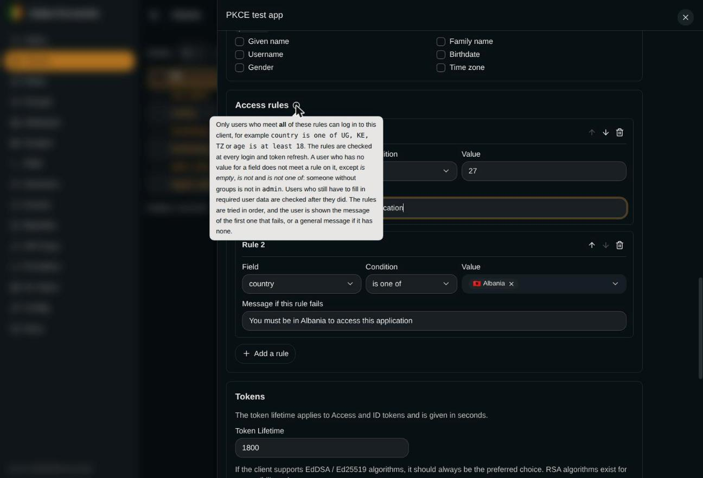
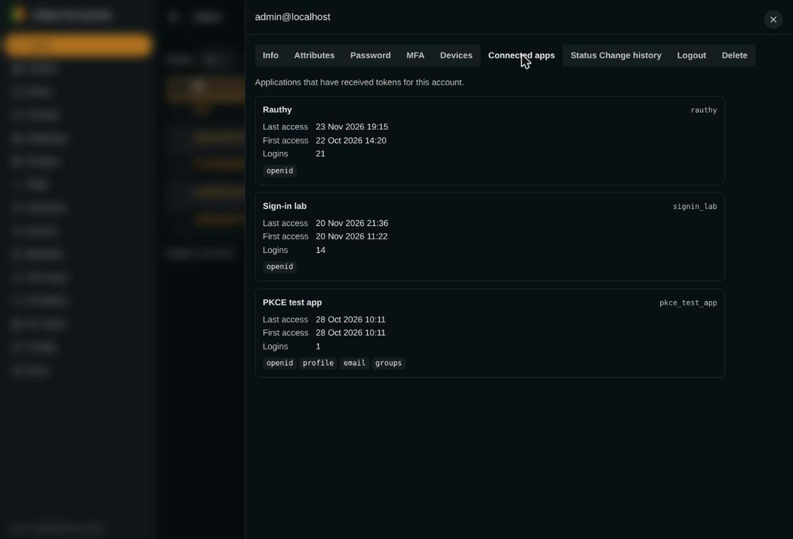

# The New Admin UI

Rauthy ships with the original UI. This fork additionally contains a second UI, in `frontend-next/`, which uses
the same routes, the same API and the same texts, so it is a drop-in replacement. It is built with SvelteKit,
Tailwind and shadcn-svelte.

## What Is Different

- all lists are sortable, searchable and paginated tables with column selection, CSV export and keyboard navigation
- details open in a side panel, and dialogs offer **Save and add new** wherever you add many entries
- bulk messages to users, roles and groups by email, SMS or WhatsApp, see [Message Channels](message_channels.md)
- verification of emails and phone numbers, see [Verifying Email and Phone](verification.md)
- typed attributes and per-client required data, see [Custom Scopes and Attributes](custom_scopes_attributes.md)
  and [Required User Data per Client](required_client_data.md)
- `Config` pages for settings stored in the database: General, User fields, Sessions & tokens, Email (SMTP) and
  Channels, see [Settings in the Database](../config/settings_db.md)

## Small Things That Help

- **The (i) icons.** Long explanations are not printed under every title. A small (i) next to the title shows them: hover it
  with a mouse or tab to it with the keyboard, on a touch screen tap it and tap elsewhere to close it.

  

- **Tables.** The top row starts with **Entries** (the page size), then search, CSV and refresh. **Add New** is always at
  the right end of the row.
- **Fields with several values** (redirect URIs, allowed origins, contacts) look like one box. Click it and a field to
  type opens; press Enter or leave the field to add the value. The X on a value removes it.
- **The service name** (`server.app_name`) is used in the page title, the header and the (i) texts.
- **Phones.** Search boxes are an icon until you tap them, the date format and language pickers are icons that open a
  small list, and tabs scroll sideways instead of being cut off.
- **Profile picture.** Tapping it shows it bigger. The pencil on its corner, or *Change picture* in the big view, changes it.
- **Unlink a provider.** The button asks first and says what happens: no more sign-in with that provider, only the
  account's own password or passkey is left, the provider's own MFA no longer counts, and the account stays.

## Connected Apps

Every user has a **Connected apps** tab, in the account page and, for admins, in the user's panel. It lists the apps that
received tokens for the account, with the first and last access, the number of logins and the scopes.



On the account page the user can remove an app. That revokes its consent (when [consents](../config/config.md) are on)
and its refresh tokens, and it ends silent sign-in for that app, see
[Sign in With No Click](fedcm_silent_signin.md). The app is listed again after the next sign-in to it.

## Building It

```bash
cd frontend-next
pnpm install
pnpm check
pnpm build:dropin
```

`build:dropin` **replaces** `templates/html` and `static/v1` with the new UI, which is what `cargo build` embeds.
Use `pnpm build` to build into `./build` only, without touching anything.

```admonish warning
Every admin page that exists as its own route also needs a page handler in the backend for a browser refresh to work
in production. The new `Config` pages (General, User fields, Sessions & tokens, Email, Channels) work when you
navigate to them inside the UI, but reloading them directly is not wired up yet.
```

## Static Settings

**Config -> Static settings** is a read-only view of the values from the config file and the environment that can only
change with a restart: server, database, encryption key ids, WebAuthn, lifetimes, events, pictures, TLS, logging, and so
on. Secrets only show `set` or `not set`, never the value. By API: `GET /auth/v1/settings/static` (admin session).

## Unread Events

The bell in the header shows how many events are newer than the point where you last read, and the Events entry in the
side navigation shows a dot. Opening the list marks everything as read.

- The marker is stored per admin in the database (table `event_read_state`), so it is the same on every browser and
  device and survives a reload.
- `GET /auth/v1/events/read` returns the marker, `PUT /auth/v1/events/read` moves it. It only ever moves forward.
- The event stream, `GET /auth/v1/events/stream?read=true` (sessions only), sends the marker as the named SSE event
  `read`, once when it opens and again whenever another tab or device moves it. Clients that do not ask for it, and every
  existing consumer of the stream, get exactly what they got before.
- In a cluster, the live update only reaches the connections on the node that took the change. The other nodes catch up
  when the tab regains focus or reconnects.
